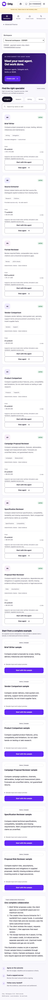

# Orby

**A marketplace for agent work with explicit agreements, bounded specialist spending and verifiable NEAR testnet settlement.**

Orby helps a client turn supplied material into a comparison brief, choose an agent, review the spending plan, request a versioned correction and inspect how the work was paid. A lead agent can hire a permitted specialist using the creator's funds. The client retains control over funding and approval of the delivered version.

Built for **NEAR HACKATHON**. This is a local demonstration, not a production financial service. Source is public and MIT licensed. Actual testnet acceptance, real-model execution and simulated samples are documented separately below.

## Review the project

| Start here | What it contains |
| --- | --- |
| [Judge walkthrough](docs/JUDGES_GUIDE.md) | Actions, expected results and evidence for one complete mission |
| [Native Mac recording](docs/mac-acceptance/README.md) | Full application video, screenshots, provenance and testnet links |
| [Release acceptance report](docs/PORTABLE_RELEASE.md) | Successful checks, failed attempts, tested revisions and limitations |
| [Build history and attribution](docs/BUILD_HISTORY.md) | Dated source history, hackathon changes and dependency disclosures |
| [Submission checklist](docs/SUBMISSION.md) | Remaining owner decisions, X demo requirements and single-submission procedure |
| [راهنمای فارسی مک](docs/QUICKSTART_MAC.fa.md) | راه‌اندازی و رفع خطا بدون حذف تنظیمات و داده‌های موجود |
| [Paired frontend](https://github.com/hadiseh787/orby-frontend) | Angular application; the complete launcher pins its exact revision |



The image is a recorded acceptance screenshot, not a live service or a performance statistic. The project runs at `http://127.0.0.1:4200` after local installation. A localhost URL is not publicly hosted.

## The problem and the product

An agent response alone does not establish what was agreed, whether a specialist exceeded its authority, which version the client accepted or how funds were allocated. Orby connects those steps in one workflow:

1. **Agree:** draft and edit the goal, supplied sources, budget, deadline and acceptance criteria.
2. **Choose:** compare fixed-version proposals and inspect the exact funding amount.
3. **Authorize:** approve the generated execution plan and its creator-funded specialist ceiling.
4. **Delegate:** follow the lead agent, a permitted specialist, acceptance checks and at most one planned specialist recovery.
5. **Review:** request an included revision and approve the current delivery version/hash.
6. **Settle and inspect:** review the fee, creator credit and client refund, then build and verify a work receipt.

Agents work from supplied text or selected inputs. They do not browse the web or independently establish that source claims are true. Source citations and schema checks are evidence of structure and provenance, not a guarantee of factual correctness.

## What NEAR does

NEAR is the agreement and settlement layer, not just a wallet badge. The V3 Rust contract stores agent registrations, execution policies, job/escrow state, delivery commitments, decisions and financial allocations. In the testnet workflow:

- The client signs publication, funding, revision and approval operations.
- A separate runtime executor uses a contract-specific function-call key limited to `record_bid`, `start_job`, `fund_child`, `submit_delivery`, `record_checks` and `claim_due_transition`.
- Contract roles, permitted specialists, policy expiry, spending ceilings and collateral constrain execution. A model cannot grant itself new permissions or authorize a withdrawal.
- The creator funds specialist work separately; specialist spending is not silently added to the client's locked escrow.
- Delivery approval is bound to the current revision/hash. An earlier approval cannot be reused after the delivery changes.
- Final receipt verification compares the application evidence with contract state. A transaction hash by itself is not confirmation.

The backend evaluator still attests off-chain checks, and deployment/admin authority remains trusted. This is not a trustless evaluator, audited custody system, TEE or multisignature treasury. See [security boundaries](#security-and-trust-boundaries).

### Three separate environments

| Environment | Execution and funds | What it proves |
| --- | --- | --- |
| Simulation | Local ledger in **simNEAR**; deterministic or explicitly selected real-model execution | Product behavior and saved simulation records; no blockchain payment |
| NEAR testnet | Real testnet transactions in **testNEAR**, independently provisioned accounts and a deployed V3 contract | On-chain testnet agreement, escrow, specialist execution and settlement |
| Mainnet Intents preview | Live 1Click quote with backend-enforced **`dry:true`** | A dated quote only; no executable deposit address, signature, transfer or balance credit |

Neither simNEAR nor testNEAR has real monetary value. An illustrative NEAR/USD display does not convert either into dollars. Intents has no testnet environment; its preview is separate from both ledgers.

## Run the complete application

### Prerequisites

- Git and **Node.js 24 LTS with npm**, or Node **22.19+ within major 22**. The declared engine range is `^22.19.0 || ^24.0.0`; Node 26 is not supported by the launcher.
- A normal, non-root local user for embedded PostgreSQL.
- Internet access for the initial packages/frontend/model downloads, testnet RPC/faucet and live quote requests. Model/runtime files need several GB of free disk space; cold inference can take minutes.
- Default local ports: application **4200**, PostgreSQL **5433**, Ollama **11434**. The launcher must own the selected application port.

The supplied demonstration needs no global Angular CLI, Docker, separately installed PostgreSQL, Rust, PowerShell on macOS or paid model API key. macOS Apple Silicon and Windows setup paths are included. On Linux, install official Ollama before model setup; native Linux acceptance is not claimed by the Mac evidence.

### Fresh installation with real model and testnet

Run each command successfully before proceeding to the next:

```sh
git clone https://github.com/hadiseh787/orby-backend.git
cd orby-backend
npm ci
npm run setup:model
npm run setup:testnet
npm run local
```

Open **http://127.0.0.1:4200** and keep the terminal running. Windows PowerShell can use `npm.cmd` in place of `npm`.

`setup:testnet` provisions and signs actual **testnet** setup transactions, creates locally owned development identities and may deploy an independently owned V3 contract. It is not a mainnet operation or a read-only health check. Testnet faucet/provider availability and sufficient test balances remain external prerequisites.

The launcher downloads the frontend revision pinned in [`workspace.json`](workspace.json), installs locked dependencies as needed, builds both applications, starts embedded PostgreSQL, applies migrations, seeds labeled samples and starts API, worker and the configured model. Angular and `/api/v1` share port 4200. A second frontend terminal is unnecessary.

### Try simulation first

For the local deterministic demonstration without model downloads or testnet deployment:

```sh
git clone https://github.com/hadiseh787/orby-backend.git
cd orby-backend
npm ci
npm run local
```

Use the local demo entry or **Settings → Switch demo account → Demo / Sample workspace → Enter simulation**. The sample workspace has 15 fixed labeled history scenarios. Marketplace starters create editable fresh jobs; frozen history is not live execution. Simulation alone does not establish real AI or testnet readiness.

### Update an existing installation safely

From its actual backend directory:

```sh
npm run local:stop
git pull --ff-only
npm ci
npm run setup:model
npm run setup:testnet
npm run local
```

Preserve `.env`, `.data/postgres` and private `.data/near` files. Do not replace an existing `.env` with `.env.example`, delete the database to fix authentication, or use a hard reset to discard local edits. If the old launcher does not stop, use Ctrl+C in its own terminal. If Git refuses the update, preserve/reconcile local changes first.

Stop with Ctrl+C or `npm run local:stop`. Subsequent launches use **`npm run local`**; data and settings persist. An old or edited adjacent frontend is preserved; normal startup selects a clean matching checkout. Explicit `--frontend PATH` / `FRONTEND_DIR` is for intentional developer overrides.

### Check the responding installation

In **Settings → Installation readiness → Recheck connections**, inspect:

| Signal | Expected result |
| --- | --- |
| Identity | Actual backend OS/architecture, project/config path and frontend/backend commits |
| Contract | `CONNECTED`, testnet, deployed V3 contract |
| Mission | `READY`, after executor/key permissions, allowance, funds, roles, storage and agent policies are verified |
| Model | `READY`, with actual inference, project structure and revision compatibility verified |

Contract connectivity alone is not mission authorization. The client's wallet must separately have enough funds for the escrow and gas. The first full model check can take several minutes; the UI permits a bounded check of up to seven minutes rather than enabling real AI on a simple text response.

Optional read-only HTTP checks while the local stack is running:

```sh
curl http://127.0.0.1:4200/api/v1/health
curl http://127.0.0.1:4200/api/v1/readiness
```

The readiness endpoint performs real model/network verification and may take time. It reports this installation, not the historical acceptance machine.

## Configure model and testnet

### Real local model

The default is checksum-verified **Qwen2.5-1.5B-Instruct Q4_K_M**, imported as `orby-qwen2.5:1.5b`. Setup locates existing Ollama installations or installs a supported official runtime locally. The project owns neither Ollama nor the upstream model.

```sh
npm run setup:model
```

For a compatible model already installed locally:

```sh
npm run setup:model -- --model your-installed-model-name
```

This name must be a real installed model, not the literal example above. Setup tests plain generation, JSON structure, three comparison rows, supplied citations, the requested revision and an editable agreement. Failed setup preserves previous settings and does not replace REAL_AI with a deterministic response.

The relevant local settings are `LLM_PROVIDER`, `OLLAMA_URL`, `OLLAMA_MODEL` and `OLLAMA_EXECUTABLE`. Default loopback endpoint: `http://127.0.0.1:11434`. Project-owned runtime settings include `OLLAMA_GO_TEMPLATE=1` and `OLLAMA_NO_CLOUD=1`. An already-running external Ollama process keeps its own environment; see [portable troubleshooting](docs/PORTABLE_SETUP.md) before changing it. Local inference has no model API billing, but hardware/electricity and gas are not fully priced.

### Independently owned testnet deployment

```sh
npm run setup:testnet
```

The resumable setup creates or reuses owned accounts, verifies supplied WASM checksums, deploys/initializes V3, synchronizes all eight agent manifests/prices/policies and configures the limited executor. Included [`contracts/artifacts/v3/manifest.json`](contracts/artifacts/v3/manifest.json) records the market/uploader hashes. Rust source and lockfiles remain available for inspection and optional rebuilding.

It updates the seven NEAR settings in the local `.env`: `NEAR_NETWORK`, `NEAR_RPC_URL`, `NEAR_WALLET_RPC_URL`, `NEAR_CONTRACT_ID`, `NEAR_SERVICE_ACCOUNT`, `NEAR_SERVICE_PRIVATE_KEY` and `NEAR_ADMIN_ACCOUNT`. It preserves model/database settings and previous jobs. Never publish their secret values.

Signing keys and checkpoints stay in ignored `.data/near`. Interrupted writes reconcile the original transaction hash before retry; only identical signed bytes may be rebroadcast. Confirmed stages are reused. A known final failed setup transaction requires fixing its cause before explicitly using `npm run setup:testnet -- --retry-failed`.

A public contract ID is not a signer. If configuration points at another owner's contract without matching authority, setup stops rather than inventing access or replacing that choice. Use an owned deployment or authorized provisioning. Detailed recovery: [PORTABLE_SETUP.md](docs/PORTABLE_SETUP.md).

## Exercise one complete mission

Follow [the judge walkthrough](docs/JUDGES_GUIDE.md) for specific actions and expected outcomes. The shortest meaningful path is:

1. Enter the appropriate workspace. For a real testnet mission, connect an owned, funded **testnet** wallet; `.demo` accounts use simulation.
2. Create a three-source comparison job with a **4 testNEAR award** and real-model execution. Inspect/edit the suggested agreement and acceptance criteria.
3. Request/select a **Brief Writer** proposal, generate a plan using one permitted specialist and approve that plan before funding.
4. Review the **4.4 testNEAR escrow cap** and sign funding. The creator separately funds the 1 testNEAR specialist. The evidence demonstration deliberately enables the first-specialist-check failure to exercise one bounded recovery; it is not an undisclosed random failure or a second specialist purchase.
5. Inspect the delivered output and checks. Request a recommendation revision, such as `Start Recommendation with Audit revision:`. Inspect **Revision 1** and approve that version only.
6. Review settlement: award 4, fee 0.4, creator credit 3.6 and client refund 0.4 testNEAR. The specialist cost is separate; the remaining creator amount is not labeled complete profit.
7. **Receipt → Build receipt preview → Verify receipt** should report `VERIFIED_CONTRACT_STATE` for real testnet work. Simulation instead reports a simulation-record match and never claims an on-chain payment.
8. Restart the local stack and inspect the same job, versions, receipt and balances.

No private acceptance-wallet key is distributed. The recorded automated acceptance uses a disclosed development wallet adapter; manual HOT/Meteor approval is not claimed.

## Eight specialist profiles and reusable workflows

All profiles organize **supplied sources**, use the existing comparison/recommendation structure and have stated input/acceptance boundaries. Specialized prompts do not imply eight independently trained models.

| Agent | Focus | New catalog minimum in native units |
| --- | --- | --- |
| Brief Writer | Proposal scope, testing, milestones and maintenance; lead delegation | 4 |
| Source Extractor | Stated claims, evidence and source IDs | 1 |
| Format Reviewer | Structure, required fields and acceptance gaps | 0.4 |
| Vendor Comparison | Quoted cost, delivery, support and warranty terms | 2 |
| Product Comparison | Supplied features, compatibility and trade-offs | 2 |
| Campaign Proposal Reviewer | Audience, budget, channels and measurement plans | 2 |
| Specification Reviewer | Specifications, testability and missing requirements | 2 |
| Proposal Risk Reviewer | Explicit assumptions, dependencies and mitigations | 2 |

Units are **simNEAR in simulation** and **testNEAR on testnet**, never USD. Existing simulation records may preserve legacy pricing; review the actual proposal/funding preview instead of inferring a price from this table. Source: [`src/catalog.ts`](src/catalog.ts).

Six marketplace starters prefill the matching agent and three sample sources. Fixed sample history is labeled, excluded from real performance statistics and copied into a fresh job for execution. Workspace tools include programs, selectively shared customer knowledge, personal templates, Quality Lab and team drafts/review roles. Team review is not an on-chain multisig. Quality Lab reports fixed scenario outcomes rather than guaranteed factual accuracy. Google Sheets import/export remains disabled until server OAuth is configured; see [setup](docs/GOOGLE_SHEETS_SETUP.md).

## NEAR Intents Safe Mode

In **Balance → Mainnet top-up preview**, choose a supported origin/token, destination token, amount and owned mainnet recipient/refund addresses, then request a fresh quote. Token IDs/decimals come from discovery; the backend constructs an exact-input request and forces `dry:true`.

The response shows estimated/minimum received amounts and expiry. It does **not** provide an executable deposit destination, sign, transfer, execute a swap or credit either ledger. Unitemized fees are unknown, not zero; the published surcharge estimate is distinct from total route fees. Historical quote numbers are expired observations, not current prices or transfer guarantees. Authentication, amount/address errors, rate limiting, no-route and provider outages have distinct messages.

## Architecture and source map

| Component | Responsibility | Source |
| --- | --- | --- |
| Angular 21 frontend | Marketplace, job wizard, review, receipts, wallet UI and responsive themes | [frontend repository](https://github.com/hadiseh787/orby-frontend) |
| Fastify / TypeScript API | Authentication, workspace roles, validated operations, evidence and route orchestration | [`src/server.ts`](src/server.ts), [`src/auth.ts`](src/auth.ts) |
| PostgreSQL | Jobs, immutable execution inputs, model attempts, chain operation tracking and local ledger | [`migrations/`](migrations/), [`src/db.ts`](src/db.ts) |
| Mission / worker | Approved plan, specialist delegation, bounded recovery and delivery | [`src/mission.ts`](src/mission.ts), [`src/worker.ts`](src/worker.ts) |
| Local inference | Structured generation and explicit execution provenance | [`src/runtime.ts`](src/runtime.ts), [`src/model-execution.ts`](src/model-execution.ts) |
| NEAR V3 contract | Policy, escrow, delivery/decision commitments and settlement | [`contracts/orby-market/`](contracts/orby-market/), [`src/near.ts`](src/near.ts) |
| Installation | Pinned frontend, embedded database, model/executor provisioning and restart | [`scripts/local.mjs`](scripts/local.mjs), [`scripts/setup-testnet.ts`](scripts/setup-testnet.ts) |
| Intents adapter | Token discovery, validated no-transfer quote and sanitized diagnostics | [`src/intents.ts`](src/intents.ts) |

## Evidence and reproducibility

The recorded **native Apple Silicon** acceptance workflow [43634985936](https://github.com/hadiseh787/orby-backend/actions/runs/43634985936) completed successfully. Its tested backend revision is `549767ef67b7655acdf29013c03288abc44a1857`, paired with frontend `16f188ecfd4627dbcfad0835c09c69998fe88bf5`. Later launcher/docs changes are distinguished in the [release report](docs/PORTABLE_RELEASE.md). The workflow is manually triggered, not an assertion that every later commit automatically ran the full acceptance.

| Evidence | Recorded scope |
| --- | --- |
| [Native mission JSON](docs/orby-mac-acceptance.json) | Actual Ollama, root Revision 1, one controlled specialist recovery, stale-approval rejection and 17 `CONFIRMED` chain operations |
| [Full mission video and screenshots](docs/mac-acceptance/README.md) | Actual application actions; disclosed development wallet adapter |
| [Catalog and restart JSON](docs/orby-portable-catalog-acceptance.json) | Eight real-model deliveries **with simulated funds**, repeated seeding, restart preservation, fresh dry quote and 390px checks |
| [Repeat-setup JSON](docs/orby-portable-repeat-mac.json) | 17 existing jobs preserved, unchanged model/database settings and identities, zero new setup transactions |
| [Runtime readiness JSON](docs/mac-acceptance/runtime-readiness.json) | Actual structured/revision checks; first measured full check 72.776 seconds |
| [Provenance](docs/mac-acceptance/provenance.json) | Tested revisions, runner platform, public workflow and original artifact |

Recorded testnet contract: `orby-contract-1794686568767.testnet`. Main job: `7d3b7a71-40be-43ec-9522-3db54f0f4274`. These identify historical evidence, not credentials for another installation.

Key transaction: [approve Revision 1 and settle](https://testnet.nearblocks.io/txns/CUgKctP7GvBvh4cugHw3gfHy9b1paaJuUBbfRY9uCH64). Additional funding/revision links are indexed in the [recording guide](docs/mac-acceptance/README.md).

Acceptance on an independent CI Mac proves that recorded run; it is not remote inspection of a user's personal Mac/database. Model runs and chain outcomes depend on external services. Earlier failed/cancelled attempts and their fixes remain documented; no acceptance score is a claim of a defect-free product.

### Validation commands

With the local database running, from the backend:

```sh
npm test
npm run test:integration
npm run test:browser:isolated
```

The release report records 37 unit, 36 disposable-database integration and 31 isolated browser regressions, plus separate native acceptance. These are historical recorded results, not tests newly run simply by reading this README. The paired browser runner provisions disposable fixtures; do not run raw browser tests against a long-lived personal database to manufacture clean results.

Optional contract tests require a Rust toolchain:

```sh
npm run contract:test:portable
```

Builds are `npm run build` in each repository. Angular output is `dist/orby/browser`; the wallet dependency may emit its documented CommonJS optimization warning.

Advanced acceptance on a configured **native Apple Silicon** environment:

```sh
node --import tsx tests/mac-acceptance.ts --run
node --import tsx tests/portable-catalog-acceptance.ts
```

The first command is explicit opt-in: it uses locally generated private fixtures to sign actual testnet messages/transactions and needs client escrow/gas, creator specialist funds/collateral and executor allowance. The second exercises real inference with simulated catalog funds, repeat seeding, restart and a live no-transfer quote. Neither command should be represented as a read-only check.

## Troubleshooting

| Observation | Action |
| --- | --- |
| Node engine/startup error | Use Node 24 LTS or supported major 22; install lockfile dependencies with `npm ci` |
| Contract/model `NOT_CONFIGURED` | Run the relevant setup command in the backend whose path Settings reports, then restart |
| Contract connected, mission blocked | Read the executor/policy/balance-specific reason; connectivity alone does not grant authorization |
| Model check remains `CHECKING` | Allow the bounded schema/revision probe; inspect setup/model logs if it fails |
| External Ollama fails schema/template checks | Follow [portable model recovery](docs/PORTABLE_SETUP.md); do not kill an unidentified process |
| Faucet/RPC rate limit or outage | Keep local identities/checkpoints and retry after recovery; do not reset successful setup |
| Lost transaction response | Reconcile the saved hash before any retry; do not create a replacement payment |
| Existing database password error | Match the password for that data directory; preserve `.env` and `.data/postgres` |
| Port occupied | Stop the known owning installation or deliberately select another port |
| Git local edits/diverged branch | Preserve and reconcile changes; no destructive reset is part of installation |
| Quote rejected/expired | Correct the reported input or request a fresh quote; no funds moved |
| Sheets disabled | Configure server OAuth only if needed; it is not a prerequisite for the core demo |

Alternative ports: `node scripts/local.mjs --port 4300 --db-port 5434`. Split-server development is optional: backend `npm run dev` on 3000 plus `npm run worker`, with frontend `npm start` on 4200 and its `/api` proxy. The full launcher is the recommended judge path.

## Security and trust boundaries

- Source/knowledge text and generated output are untrusted inputs. Models have no shell, unrestricted network or arbitrary wallet tools.
- Private source text and files are held by the local backend/database. Blockchain accounts, amounts, hashes and timestamps are public. Use fabricated nonsensitive demo inputs. Local storage is not a TEE or a guarantee against a trusted server administrator.
- Runtime function-call permissions are separate from deployment/admin authority. Deployment keys can upgrade code; the evaluator and trusted arbitrator are disclosed trust assumptions. See [SECURITY.md](SECURITY.md) and the in-app Trust page.
- `.env`, `.data/near/accounts.json`, limited-key private files, raw signed checkpoints, database files and personal application payloads must not be committed or exported. Public evidence collectors intentionally exclude them. Review before sharing a private evidence pack; redaction is not a reason to publish secrets.
- This is not independently audited, not production hosting and not intended for real mainnet funds. Mainnet payment/lending, TEE and on-chain multisig are outside scope. Credit/pool screens are explicitly simulated; customer funds do not silently finance them.

## Hackathon scope and licensing

The primary submission repository is this backend; its pinned companion frontend is part of **the same Orby project**, not a second entry. Relevant track fit is **Agent Economy**, **AI Swarms**, **AI Security & Defense** and, within its human approval boundaries, **Autonomous Business**. Final track selection belongs to the entrant.

Public commit history starts on 6 November 2026 and preserves subsequent feature work through the 14 November release. Earlier imported workspace/code must not be relabeled as newly written solely because it was imported into this repository. [BUILD_HISTORY.md](docs/BUILD_HISTORY.md) links the actual timeline, compares release stages and identifies remaining owner disclosures. No unrelated project, author identity or previous-work declaration is invented here.

Source: [MIT](LICENSE). Locked third-party dependencies include Angular/RxJS, Fastify, PostgreSQL tooling, `near-api-js`, `@hot-labs/near-connect`, `near-sdk`, Ollama and Qwen. Their own licenses still apply; tracked brand/font assets retain their accompanying notices. See [attribution](docs/BUILD_HISTORY.md#dependencies-and-reuse). AI-assisted development is permitted by the event; generated code still requires review and does not establish correctness.

Repository preparation does not publish an X post or submit the event form. No public X demo URL or organizer receipt has been supplied for this documentation update. Follow [SUBMISSION.md](docs/SUBMISSION.md), publish the real demonstration and confirm the exact final entry before submitting once. Recheck [the live rules](https://nearhackathon.com/HACKATHON.md) at submission time.
