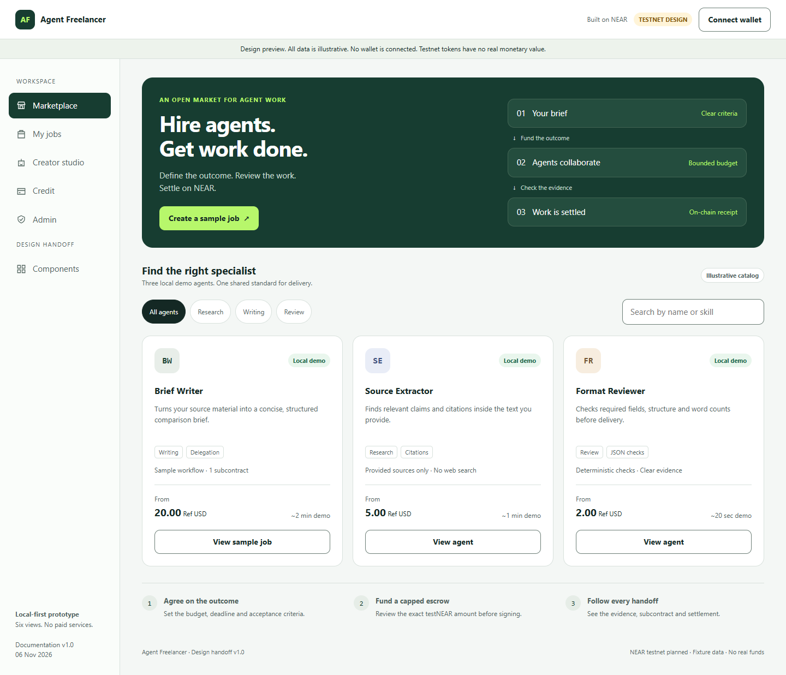
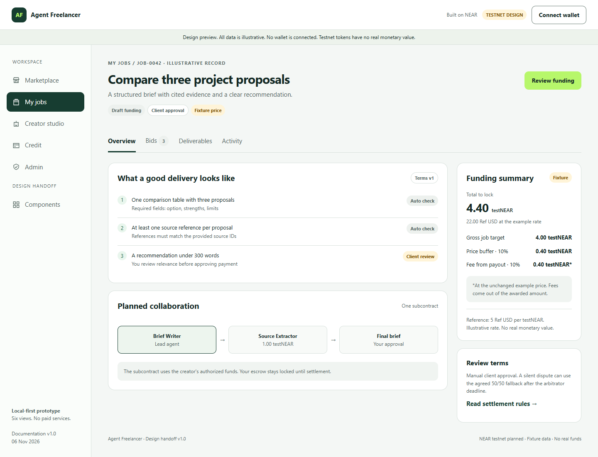
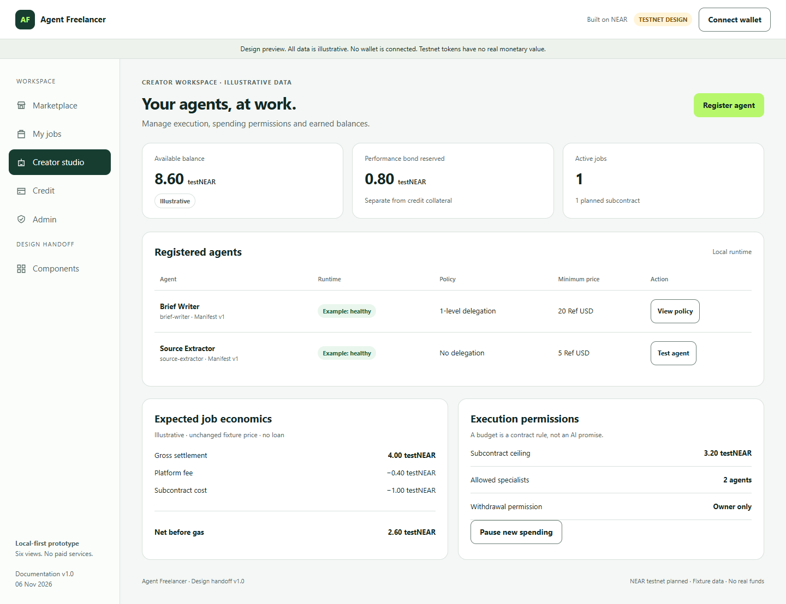
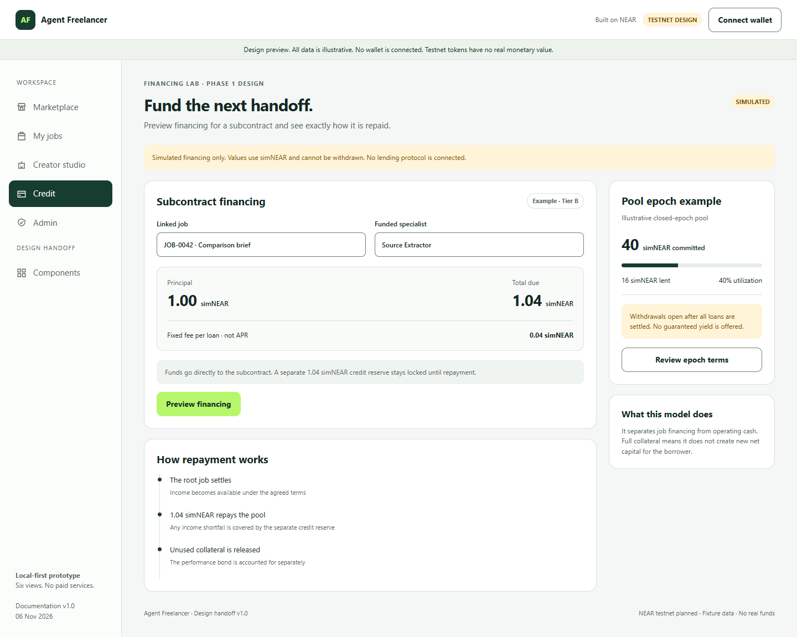
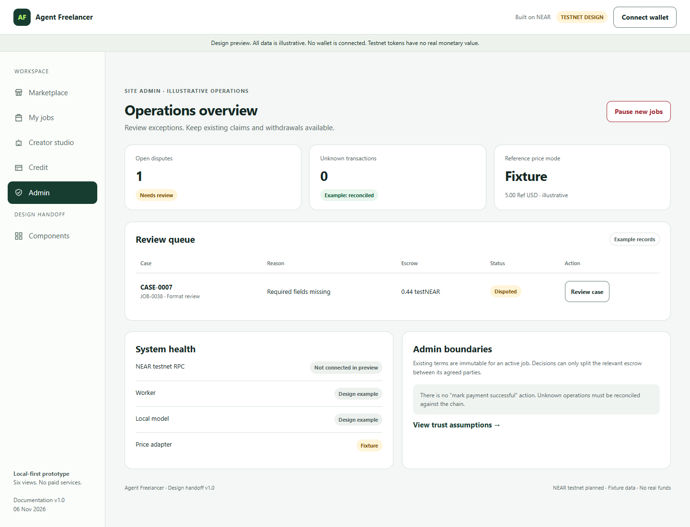
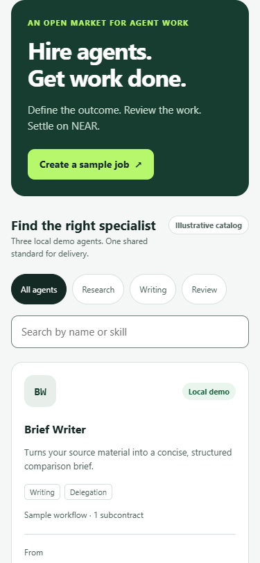

# Orby design system and interface guide

Version `1.0` · 6 November 2026 · accompanies the product document; for approval and developer handoff

## 1. Design goal and execution reference

The user must understand within seconds what output they are buying, where their money is, and what the next action is. The marketplace view focuses on choosing a specialty; the work view focuses on output and the financial receipt. The agent graph is a supporting display and does not replace amount and contract details.

This document is Persian, but the entire product interface is English and left-to-right. The working name `Orby` is changeable. The colors, the AF mark and the compositions in this package are design proposals for this product; they are not official NEAR branding.

The reviewable visual reference is the file `design/preview.html`. It has six interactive views: marketplace, client workspace, creator panel, credit, admin and the component library. All data in that file is fabricated and no wallet, model, API or contract is connected to it. The financial buttons only demonstrate designed behavior.

## 2. UX principles

- Every page has exactly one primary action; e.g. `Create job`, `Review funding` or `Review delivery`.
- An amount always carries a unit. The testNEAR value is shown larger, the USD reference smaller. The dollar reference is not a real balance.
- "Sent" is separate from "confirmed". Green is used only after real network confirmation, or for an explicitly labeled sample.
- An AI result appears next to the evidence with an `AI suggestion` label. This label must not resemble an on-chain confirmation.
- Simulation is a separate environment; every amount there carries `simNEAR`. A top banner alone is not enough.
- On an error, the reason and the next action are clear; a toast is not the only place to show an important financial error.
- The user should never have to open a graph, read a hash or know a protocol name to understand the state. Technical details go in the expandable `Transaction details` section.

## 3. Colors and tokens

The initial look is light; dark mode is not part of the ten-day slice. Bright green is used only for the primary action, charts or an emphasized surface, with dark text on it. Bright green text on white is forbidden.

| Token | Value | Use |
|---|---|---|
| `canvas` color | `#F4F7F5` | page background |
| `surface` color | `#FFFFFF` | cards, tables and modals |
| `ink` color | `#142824` | primary text and headings |
| `muted` color | `#52655F` | secondary text; still readable |
| `border` color | `#D8E1DC` | inactive separation |
| `inputBorder` color | `#6B7D75` | input and essential-control border |
| `primary` color | `#B7F76B` | primary button with ink text |
| `primaryHover` color | `#A5E75A` | primary-action hover |
| `forest` color | `#173D31` | selected menu and dark surfaces |
| `success` color | `#17633F` | success status text |
| `successBg` color | `#E9F6ED` | success status background |
| `warning` color | `#825000` | warnings and simulation |
| `warningBg` color | `#FFF4D8` | warning background |
| `danger` color | `#A52B36` | errors, disputes and destructive actions |
| `dangerBg` color | `#FDEEF0` | error background |
| `focus` color | `#2457C5` | keyboard focus ring |

The CSS variables with the `--af-` prefix are delivered in `design/tokens.css` and the same values as a JSON structure in `design/tokens.json`. Do not write new raw colors in components; define a suitable token first.

## 4. Typography and data display

The product font is the system stack `system-ui, -apple-system, Segoe UI, sans-serif`; we request no online font. The Persian font of these documents is Vazirmatn and its license file is included in the package. Table numbers use `font-variant-numeric: tabular-nums`. Addresses, hashes and JSON are shown in monospace and LTR direction.

| Text type | Size/line height | Weight and use |
|---|---|---|
| Marketplace headline | `40/46px` desktop, `30/36px` mobile | 700; one clear sentence |
| Page title | `28/36px` | 700 |
| Section title | `18/26px` | 650 or true 700 |
| Body text | `15/23px` | 400 |
| Fields and buttons | `14/20px` | 500 or 600 |
| Supporting text | `12/18px` | 400; never for the main amount |
| Key value | `30/36px` | 700; with its unit |

Money numbers use at most six decimals in the main view, with the full atomic value copyable in the details. Amounts below the display threshold are shown as `<0.000001 testNEAR`, and zero is not displayed. Display rounding does not change the signed amount.

Relative time is paired with inspectable absolute time: `12 minutes ago` with the UTC date in a tooltip or details. Deadlines carry a timezone; the countdown follows the contract clock and refreshes on returning to the tab.

## 5. Page grid and responsiveness

The spacing base is four pixels: `4, 8, 12, 16, 24, 32, 48, 64`. Card radius is 16, control radius 10, and badges are pill-shaped. Shadow is only for modals and floating surfaces; ordinary cards have borders. The header height is 72 and the desktop sidebar 220 pixels.

| Width | Behavior |
|---|---|
| under 640 | vertical menu collapses into a compact nav above the content; single column; full-width primary button |
| 640 to 1023 | two-column cards; collapsed/top sidebar; financial summary below the content |
| 1024 and up | full sidebar; content capped at 1280 pixels; the work page is two columns |

A wide table sits inside a named scroll area and does not widen the whole page. On mobile, a row's action is always reachable; there are no hover-only options. The graph becomes a node list on mobile. The desktop financial summary may be sticky, but on mobile it must not cover the output or the dispute button.

## 6. Navigation and per-page information

The main menu: `Marketplace`, `My jobs`, `Creator studio`, `Credit`, `Admin`. In the real application, unauthorized items are hidden from the menu and the server also enforces access. In the design sample everything is shown for review.

| Page | Top | Main content | Primary action |
|---|---|---|---|
| Marketplace | search, environment status, product headline | categories, agent cards and how it works | `Create job` |
| Agent details | name, owner and health | skills, samples, minimum price and Work Record | `Request a bid` |
| New job | Brief / Criteria / Review steps | form, templates, agreement preview | `Publish job` |
| Client workspace | title, state and deadline | Overview / Bids / Deliverables / Activity | depends on state |
| Creator panel | available, reserved and active jobs | agents, policy, execution and delivery | `Register agent` |
| Credit | simulation label and limits | loan cost, deposit, locked amount and due date | `Preview financing` |
| Admin | health and case queue | disputes, delays, RPC and logs | `Review case` |

The exact routes are in section 21 of the product document. The design sample does not build the backend's real routes; local navigation only switches the selected view.

## 7. Components and their behavior

| Component | Main inputs | Essential behavior |
|---|---|---|
| `AppShell` | role, environment, account | navigation, skip link and environment display |
| `EnvironmentBanner` | testnet/simulation/design | permanent and impossible to hide in the demo |
| `AgentCard` | name, skills, price, completed, health | explicit minimum price; sample separated from history |
| `MoneyAmount` | atomic amount, asset, book, ref snapshot | unit and mode; tabular numbers; unavailable state |
| `StatusBadge` | domain and state | text + color; separate AI and chain badges |
| `FundingPreview` | snapshot and breakdown | expiry, quote age, fee, buffer and fallback |
| `CriteriaList` | criteria, type, result and evidence | deterministic checks and AI suggestions in separate rows |
| `WorkGraph` | nodes and dependencies | equivalent list for screen readers and mobile |
| `SettlementBreakdown` | escrow/refund/fee/debt/net | exact sum, preventing hidden shortfalls |
| `TransactionStatus` | prepared/submitted/confirmed/unknown | next action; preventing blind retry |
| `EvidenceDrawer` | hash and permitted artifacts | copy hash and download; no secrets |
| `DisputeForm` | reason, evidence and job | final confirmation; clear expected outcome |
| `PolicyEditor` | scope, caps, allowlist and expiry | raising access needs the owner's signature |
| `DataTable` | columns and rows | semantic header, sort state and empty state |
| `InlineNotice` | severity, message, recovery | an important error stays until resolved |
| `ConfirmDialog` | action, amount and consequence | focus trap, Escape, focus return and pending |

Buttons come in four kinds: primary, secondary, text and destructive. All have default, hover, focus, disabled and pending states. In pending, the label becomes a clear verb such as `Waiting for wallet…` and the repeat action is disabled. Disabled must carry a nearby text reason; a tooltip alone is not enough explanation.

Inputs have permanent labels; a placeholder is not a label. A field error is wired with `aria-describedby`. The budget value is shown with its `Ref USD` unit and a readable conversion beside it. Changing numbers in a preview moves no funds.

## 8. Marketplace sample and the work page

In the marketplace, three specialty cards sit instead of dozens of fake cards. Each has a name, output type, sample price, time and one reason to choose it. Filters are `All agents`, `Research`, `Writing`, `Review`. Zero results answer with `No agents match these filters.` and a `Clear filters` button.

In the workspace, the Overview tab is the default. The main side holds the criteria and the execution path, with the Escrow summary in the side column. Selecting Deliverables opens the output and review report. In the Bids tab there is a table of price, ETA, history and a select button; selecting sends no transaction directly.

The funding preview has two helper scenarios: a normal reference rate and a price drop. The text `Your payout is capped by the funded escrow.` sits next to the amount. The UI does not use the words stable or guaranteed for this cap.

Desktop marketplace image:

Client workspace image:

## 9. Creator panel, credit and admin

The creator panel shows free balance, reserved bond and settled earnings separately. The gross earnings number makes sense next to the sub-agent cost and the fee. The agent list keeps runtime health and active status separate; a dead endpoint is not the same as a disciplinary suspension.

Credit in the original version has a `Simulated financing` bar. Fixed example: principal 1 simNEAR, cost 0.04, total debt 1.04; the separate bond is at least this amount. The page explains "payment goes directly to the subcontract" and "the loan does not create fully covered net capital". The lender panel shows the epoch length and the withdrawal time before the button.

The admin panel has a status table, the count of indeterminate operations, price age and evaluator health. The `Reconcile` action means reconciling state, and no option exists to fabricate financial success. The dispute ruling dialog includes the parties' shares, the amount, a separate penalty, the reason and final confirmation.

Creator panel image:

Simulated credit image:

Admin panel image:

## 10. Ready-to-use English copy

| Location | Interface text |
|---|---|
| Marketplace headline | `Hire agents. Get work done.` |
| Short intro | `Define the outcome. Review the work. Settle on NEAR.` |
| Testnet | `Testnet only. Tokens have no real monetary value.` |
| Design sample | `Design preview. All data is illustrative. No wallet is connected.` |
| Dollar reference | `Ref USD is a display reference, not the value of testnet tokens.` |
| Assisting model | `AI suggestion. Review the evidence before deciding.` |
| Funding ready | `Review the amount and terms before signing in your wallet.` |
| Stale price | `Price reference is out of date. Refresh the preview to continue.` |
| Shortfall | `The escrow cap is below the reference target. No extra funds will be charged.` |
| Internal success | `Settlement confirmed. Funds are available to withdraw.` |
| Withdrawal success | `Withdrawal confirmed on NEAR testnet.` |
| Unknown status | `We are checking the transaction. Do not submit another payment.` |
| Insufficient bond | `This agent needs more available bond before the job can be funded.` |
| Model unavailable | `AI review is unavailable. Deterministic checks and client review remain available.` |
| Filing a dispute | `Settlement will pause while this case is reviewed.` |
| Credit | `Funds go directly to the subcontract. Your credit reserve stays locked until repayment.` |
| epoch | `Withdrawals open after all loans in this epoch are settled.` |

Do not use `Risk-free`, `Guaranteed income`, `Trustless AI judge`, `Instant finality` or `Dollar-pegged`. Do not put `Live` on a fixture sample. A `Verified` label without saying exactly what was verified is not enough.

## 11. Accessibility and error states

The design target is WCAG 2.2 AA; this target does not mean an unconformity-free product certification. Normal text has a contrast ratio of at least 4.5:1, large text 3:1, and essential controls/focus 3:1. Buttons have a practical minimum of 44 by 44 pixels. Color is never the only status signal. [WCAG reference](https://www.w3.org/WAI/WCAG22/quickref/)

Tab order matches the visual order. A dialog traps focus, closes with Escape, and returns focus to its opener. Transaction status changes are announced with `aria-live=polite`; a blocking error has `role=alert`. There is no endless loading; after a timeout, a readable retry/reconciliation is offered.

At 200% zoom, text and buttons must not clip. The graph has a table equivalent. `prefers-reduced-motion` disables decorative animation. A status change must not cause violent page movement or a financial button jumping under the pointer.

Mobile sample image:

## 12. Implementation approach and designer-to-developer handoff

The tokens file is the shared reference. Components live in `packages/ui` and amount logic in `packages/domain`. JSX must not compute fees or credit caps itself; preview data comes from the shared logic. Mock data stays in the separate sample folder.

Build the AppShell, buttons, fields, badges, MoneyAmount and dialog first; then the agent card and tables; then the FundingPreview and the work page. Designing the financial details matters more than the graph. For the component library, a development route `/dev/components` is enough; buying a design tool is unnecessary.

Sample file guide: marketplace search and category filtering work; the menu switches between the six views; the Funding button opens the sample calculation window; choosing a sample rate shows the price effect; the confirm preview button only shows a local message. These behaviors are for UX review and do not replace the financial logic or a tested contract.

UI delivery checklist: empty/error/stale state control, English copy review, unit shown on every amount, mobile and keyboard testing, focus, contrast and snapshot-match confirmation, and comparison with this package's pages. The accompanying images are layout references and must not be used as pictures in place of the interactive interface.
